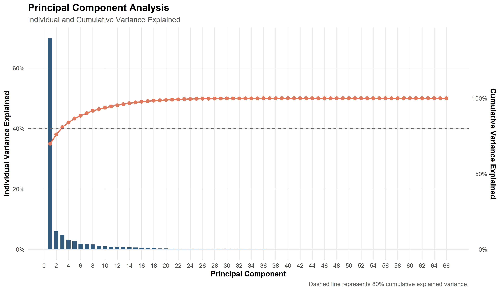
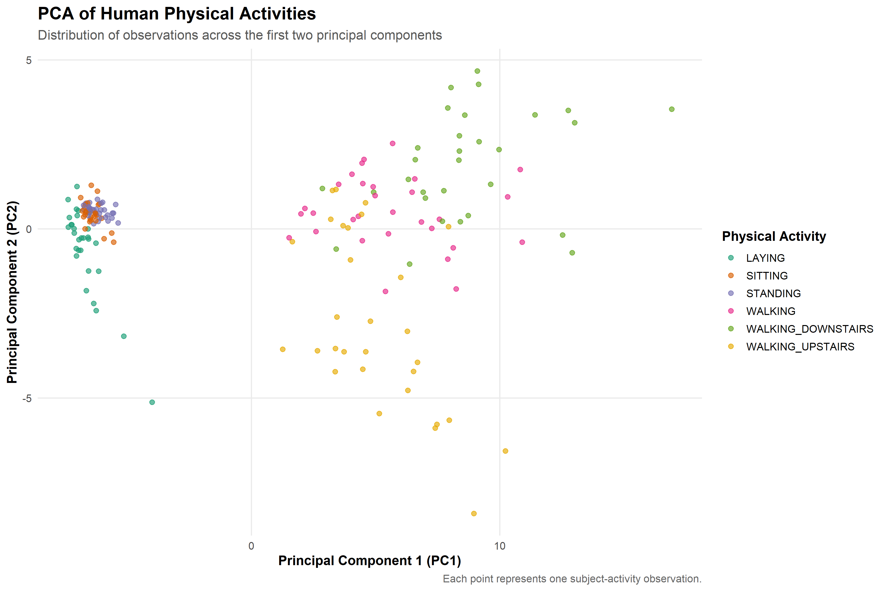

# Getting and Cleaning Data – UCI HAR Data Analysis Project
## 1. Project Overview
This project is based on the Getting and Cleaning Data course and the UCI Human Activity Recognition (HAR) Using Smartphones Dataset.
The project focuses on preparing a tidy dataset, performing Exploratory Data Analysis (EDA), and applying Principal Component Analysis (PCA) to investigate patterns in human physical activities.
## 2. Dataset
The tidy dataset contains:
- 180 observations
- 68 variables
- 30 subjects
- 6 physical activities
Each observation represents one subject performing one activity. The measurement variables contain the average values of selected sensor measurements.
The six activities included in the dataset are:
- WALKING
- WALKING_UPSTAIRS
- WALKING_DOWNSTAIRS
- SITTING
- STANDING
- LAYING
## 3. Tools and Technologies
- R
- RStudio
- dplyr
- ggplot2
- Principal Component Analysis (PCA)
## 4. Exploratory Data Analysis
The analysis includes:
- Examining dataset dimensions and structure
- Exploring the distribution of six physical activities
- Comparing body acceleration across activities
- Calculating mean, median, range, and standard deviation
- Creating bar plots, box plots, and comparison charts
## 5. Principal Component Analysis
PCA was performed on standardized numerical sensor measurements.
The analysis includes:
- Selecting numerical features and excluding subject identifiers
- Standardizing numerical variables
- Performing PCA using `prcomp()`
- Visualizing explained variance with a scree plot
- Extracting and visualizing the first three principal components
The first three principal components collectively explain at least 80% of the total variance in the standardized sensor measurements.
## 6. Visualizations
### PCA Scree Plot

### PCA Scatter Plot

---
## 7. Key Findings
- The dataset contains six human activities.
- Body acceleration measurements vary across different activities.
- PCA reduces the dimensionality of the sensor measurements.
- The first three principal components capture at least 80% of the total variance.
## 8. Files
- `eda_analysis.R`: R script for exploratory data analysis and PCA.
- `tidydata.txt`: Tidy dataset containing 180 observations and 68 variables.
- `figures/pca_scree_plot.png`: Scree plot showing individual and cumulative explained variance.
- `figures/pca_scatter_plot.png`: PCA scatter plot showing observations across the first two principal components.
## 9. How to Run
1. Download or clone this repository.
2. Open `eda_analysis.R` in RStudio.
3. Set the working directory to the project folder.
4. Install the required R packages: `dplyr` and `ggplot2`.
5. Run the script to reproduce the analysis and visualizations.
## 10. Data Source
UCI Machine Learning Repository: Human Activity Recognition Using Smartphones Dataset.
